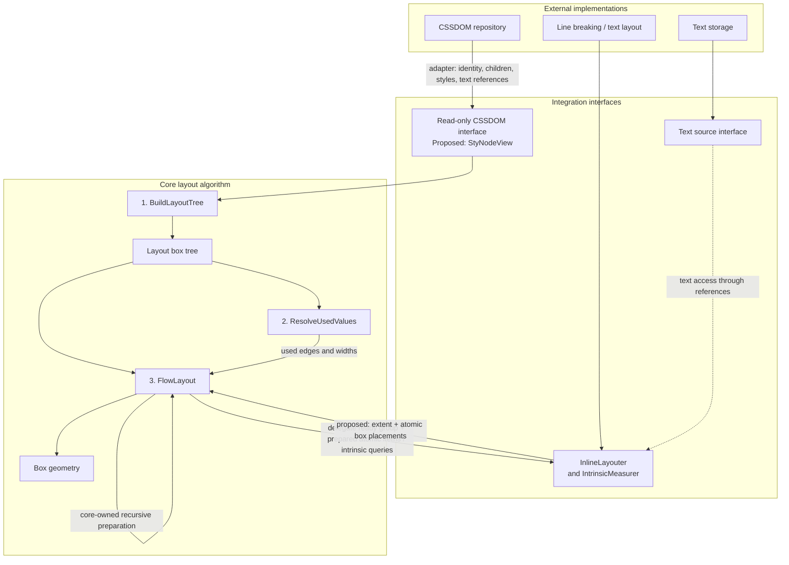
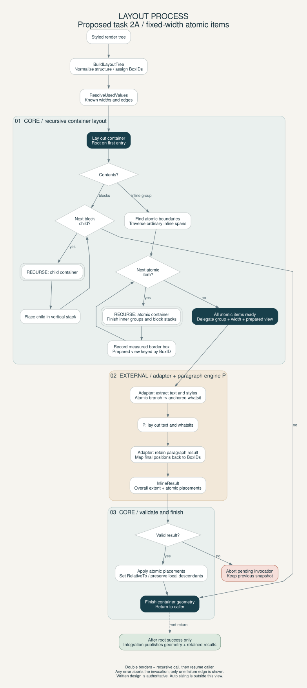

# Architecture and Integration Interfaces

Implementation update: tasks 2A/3A and bounded auto-width tasks 2B/3B are
implemented. Core measures nested intrinsic bounds, selects auto content widths,
resolves descendants privately, then performs final layout. Fixed pixel widths
including zero remain supported; percent/em widths on atomic boxes remain rejected.
Percentage dependencies on unknown auto widths fail explicitly; definite bases
remain supported. See [current API](Pass-Signatures.md#intrinsic-measurement).
Diagrams illustrate the fixed-width final-layout phase, not intrinsic measurement.
Real tytui/P integration, full baseline behavior and speculative trials remain open.


The core layout algorithm consumes a styled DOM, text references, and external
inline-layout services. External implementations connect through adapters;
they should not dictate the core algorithm's structure.

This diagram shows the intended integration, not a package-import graph.
The algorithm contract is [CSS-Algo-Overview.md](CSS-Algo-Overview.md);
current Go signatures are documented in [Pass-Signatures.md](Pass-Signatures.md).



## Interface responsibilities and current status

- **CSSDOM:** intended to expose source identity, ordered children, computed
  styles, and text references through a read-only adapter. `StyNodeView` is an
  incomplete proposal; BuildLayoutTree currently accepts the concrete local
  `RenderNode` stub. The proposal still exposes `html.Node` and lacks explicit
  identity and text-source access. See [Tree-Type.md](Tree-Type.md).
- **Text:** layout boxes carry `TextRef` source IDs and byte ranges. The current
  `TextSource` interface exposes identity and byte length; source lookup and
  actual text access for external layout/shaping still need adapter design.
  The dashed edge represents that intended connection, not completed wiring.
- **Inline layout:** `InlineLayouter` returns InlineResult with extent plus atomic-box placements,
  not paragraph lines.
  Its request
  includes group/owner identities and a read-only used-values view. Typed paragraph
  results stay in an invocation-local adapter table; the integration layer joins
  them with geometry after success. IntrinsicMeasurer.MeasureInline measures one inline group's
  min/max content widths with core-prepared intrinsic atomic bounds and an
  edges-only view; see Pass-Signatures.md section 4.1. Measurement never publishes
  paragraph results and need not share the final layouter implementation.
- **Atomic preparation (target):** core discovers and recursively lays out atomic
  subtrees before delegating each group. The adapter receives read-only prepared
  border-box items keyed by BoxID, translates them for P, and retains their final
  placements. It does not initiate sizing. The diagram shows this target; Go now
  uses prepared views and atomic placement output (checklist 2A/3A).
  Concrete prepared lookup and placement output are documented in Pass-Signatures.md,
  including branch lookup by BoxID and explicit geometry.RelativeTo. P's whatsit
  encoding/position storage remains private; the types are implemented;
  see [integration section 4.1](Document-Layout-Integration.md#41-core-owned-recursive-inline-block-preparation).

## Reading the pipeline

BuildLayoutTree normalizes structure. ResolveUsedValues resolves edges and known
widths. FlowLayout stacks blocks and delegates inline layout, producing box geometry. Lines and glyphs remain in the
adapter-owned paragraph result. CSSDOM creation, text storage, line breaking, and shaping remain
external responsibilities; shaping is outside this diagram's detail level.

The three passes express conceptual ownership. Auto-width inline-blocks require late resolution: descendants must use the final inline-block width,
and relevant edges must be resolved before their line breaking. The diagram
does not imply that one unconditional resolution traversal solves that dependency.
See [Current-Checklist.md](Current-Checklist.md), tasks 2 and 3.

## Layout process flowchart

This visual aid depicts the fixed-width task-2A design, now implemented in core. The written
[core contract](CSS-Algo-Overview.md) remains authoritative; concrete proposed
types are in [Pass-Signatures.md](Pass-Signatures.md#prepared-atomic-items-and-placement).
For the order of external calls, see the
[single-inline-block sequence](Document-Layout-Integration.md#single-inline-block-call-sequence).

After construction and used-value resolution, FlowLayout runs the recursive
container procedure below. Double-bordered boxes mean a recursive call to that
same procedure, followed by resuming the caller. Each atomic container's inner
groups finish before its outer group is delegated. Auto sizing is outside this
diagram's scope; fixed atomic descendant widths must be resolved before layout.



[Editable DOT source](diagrams/layout-process.dot). Regenerate from the repository root:

```sh
dot -Tsvg doc/diagrams/layout-process.dot -o doc/diagrams/layout-process.svg
```

Publication happens only after the root returns successfully: the integration
layer publishes geometry and retained paragraph results together. Any error,
including during preparation or an external call, aborts the pending document;
the failure edge drawn above is representative, not the only failure source.
The previous successful snapshot remains unchanged.
