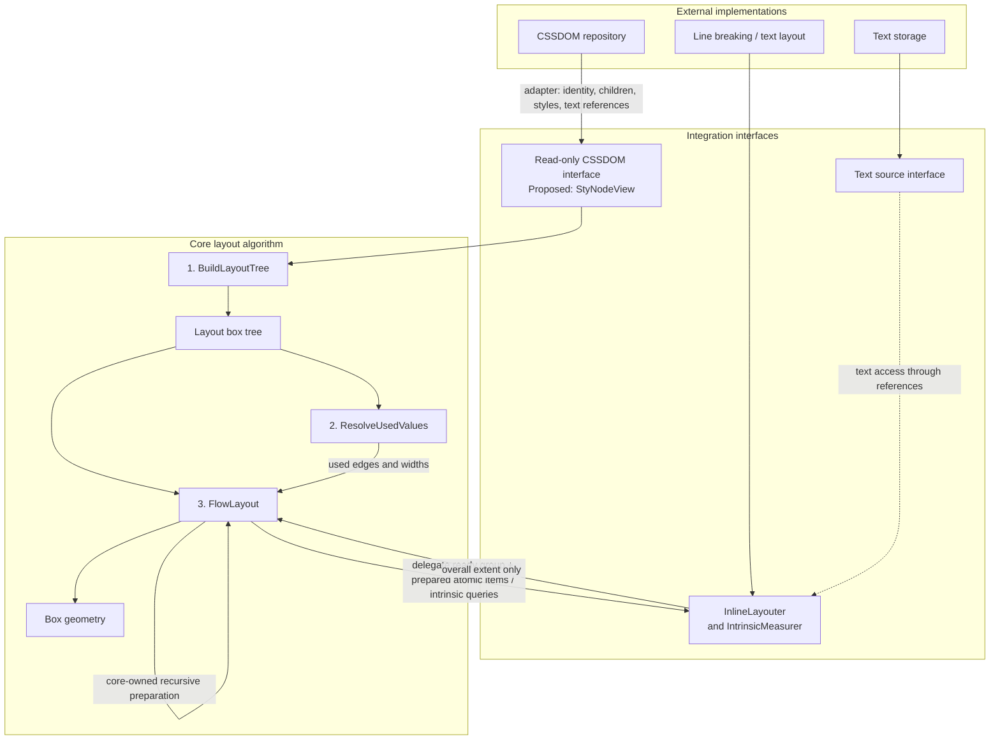

# Architecture and Integration Interfaces

The core layout algorithm consumes a styled DOM, text references, and external
inline-layout services. External implementations connect through adapters;
they should not dictate the core algorithm's structure.

This diagram shows the intended integration, not a package-import graph.
The algorithm contract is [CSS-Algo-Overview.md](CSS-Algo-Overview.md);
current Go signatures are documented in [Pass-Signatures.md](Pass-Signatures.md).

## Interface responsibilities and current status

- **CSSDOM:** intended to expose source identity, ordered children, computed
  styles, and text references through a read-only adapter. `StyNodeView` is an
  incomplete proposal; BuildLayoutTree currently accepts the concrete local
  `RenderNode` stub. The proposal still exposes `html.Node` and lacks explicit
  identity and text-source access. See [Tree-Type.md](Tree-Type.md).
- **Text:** layout boxes carry `TextRef` source IDs and byte ranges. The current
  `TextSource` interface exposes identity and byte length; source lookup and
  actual text access for external layout/shaping still need adapter design.
  The dashed edge represents that intended connection, not completed wiring.
- **Inline layout:** `InlineLayouter` returns overall extent only. Its request
  includes group/owner identities and a read-only used-values view. Typed paragraph
  results stay in an invocation-local adapter table; the integration layer joins
  them with geometry after success. `IntrinsicMeasurer` supplies max-content
  widths independently; it need not share an implementation.
- **Atomic preparation (target):** core discovers and recursively lays out atomic
  subtrees before delegating each group. The adapter receives read-only prepared
  border-box items keyed by BoxID, translates them for P, and retains their final
  placements. It does not initiate sizing. The diagram shows this target; Go still
  exposes the superseded AtomicSizer callback pending checklist 2A/3A migration.
  Concrete prepared-item access, P's atomic input, and placement output remain open;
  see [integration section 4.1](Document-Layout-Integration.md#41-core-owned-recursive-inline-block-preparation).

## Reading the pipeline

BuildLayoutTree normalizes structure. ResolveUsedValues resolves edges and known
widths. FlowLayout stacks blocks and delegates inline layout, producing box geometry. Lines and glyphs remain in the
adapter-owned paragraph result. CSSDOM creation, text storage, line breaking, and shaping remain
external responsibilities; shaping is outside this diagram's detail level.

The three passes express conceptual ownership. Auto-width inline-blocks still
need a scheduling design: descendants must use the final inline-block width,
and relevant edges must be resolved before their line breaking. The diagram
does not imply that one unconditional resolution traversal solves that dependency.
See [Current-Checklist.md](Current-Checklist.md), tasks 2 and 3.
