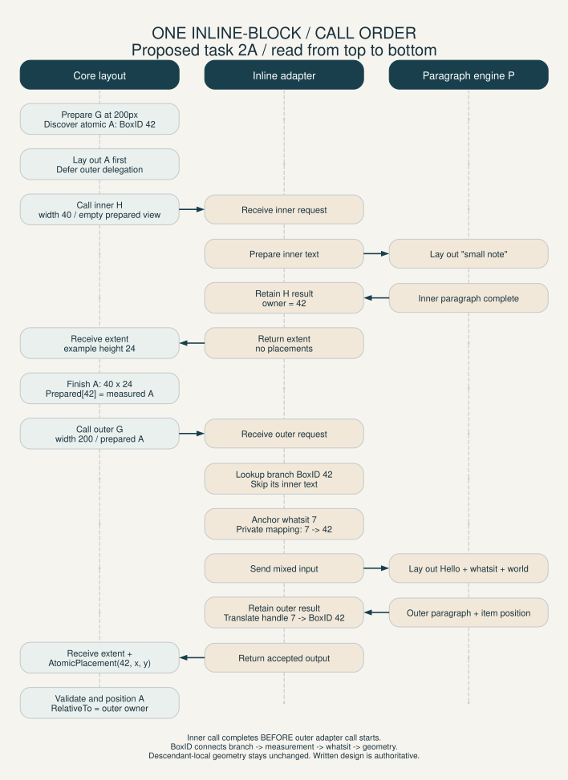

# Document Layout Integration

Implementation update: tasks 2A/3A and bounded auto-width tasks 2B/3B are
implemented. Core measures nested intrinsic bounds, selects auto content widths,
resolves descendants privately, then performs final layout. Fixed pixel widths
including zero remain supported; percent/em widths on atomic boxes remain rejected.
Percentage dependencies on unknown auto widths fail explicitly; definite bases
remain supported. See [current API](Pass-Signatures.md#intrinsic-measurement).
Diagrams illustrate the fixed-width final-layout phase, not intrinsic measurement.
Real tytui/P integration, full baseline behavior and speculative trials remain open.


Assessment and implementation plan, 2026-11-12. Extent-only boundary now implemented
in the core; M3/M4 core verification updated 2026-11-13. Actual tytui integration
remains outstanding.

This document evaluates the collaboration proposed in tytui's
[three document-layout views](../../tytui/doc/DOCUMENT_LAYOUT_VIEWS.md), especially
View 3, and its [exploration](../../tytui/doc/DOCUMENT_LAYOUT_EXPLORATION.md).
It records integration-specific reasoning and acceptance targets, not a second
general roadmap. Typed retention and extent-based flow are implemented;
section 4.1 describes the addition of atomic placements. Remaining
implementation gaps and integration decisions are identified separately.

The current authoritative contract remains
[CSS-Algo-Overview.md](CSS-Algo-Overview.md). General priorities and implementation
checks live in [Exec-Roadmap.md](Exec-Roadmap.md) and
[Current-Checklist.md](Current-Checklist.md). Current API details are in
[Pass-Signatures.md](Pass-Signatures.md).

## 1. Scope and ownership

The architectural direction fits this module: width goes down; height comes back.

- css-box-layout constructs normalized boxes, resolves supported used dimensions,
  supplies available content widths, and positions block containers.
- The inline-group adapter extracts one complete normalized group, preserves
  source correspondence, prepares typography inputs, and converts units.
- The paragraph engine shapes, breaks, and internally stacks lines, returning
  local geometry and retained glyph content.
- The document compositor places retained paragraphs through box geometry and
  combines them with separate paint information. It does not reshape text.

A paragraph is a leaf of the outer positioning problem. Its lines must not be
stacked again by block flow. Group boundaries come from normalized boxes, not
HTML paragraph tags or a second traversal that reselects DOM subtrees.

The first experiment is continuous normal-flow LTR layout with definite widths
and natural height. Begin with zero edges, then add padding, borders, and additive
margins. Pagination, floats, positioning, flex/grid, atomic inline items, intrinsic
sizing, margin collapse, and DOM line-height extraction remain outside this
experiment. Paragraph bidi capability does not imply outer RTL layout support.

## 2. Readiness assessment

The complete document path is not ready. The callback scheduling design has been
superseded by section 4.1. The following table preserves the original pre-fix assessment from 2026-11-12;
it is not current implementation status. See milestones and section 3 for progress.

| Area | Current behavior | Integration consequence |
|---|---|---|
| Inline delegation | Flow passes an anonymous inline root and content width to InlineLayouter | Suitable connection point; flow does not restack returned lines |
| Mixed-run normalization | `normalizeBlockChildren` retains slices whose backing storage is reused for later runs | Later text can overwrite an earlier group's children |
| Styles | Box constructors omit LayoutNode.Style | Render-input widths and edges do not reach resolution |
| Text identity | Builder assigns source 0 and node-local byte ranges | TextRef alone cannot identify distinct source text nodes |
| Paragraph height | Flow derives height from maximum line Y + H | Full vlist extent, including trailing spacing, cannot be expressed independently |
| Result retention | Lines are retained only for BoxBlock and BoxInlineBlock owners | Anonymous groups lose their line payloads from LayoutResult |
| Coordinates | Child placement adds the parent's Content offset | Violates parent-content-relative coordinates when edges are nonzero |
| Snapshots | Flow writes geometry onto shared input nodes | A later layout changes geometry reachable through an older result's Root |
| Request data | Callback receives root, width, and atomic sizer, but no used-value view | Adapter access to resolved inline edges is unspecified |
| Resize | FlowLayout ignores LayoutContext | A constraint change requires used-value recomputation, not just a new flow context |

Relevant source: [flow.go](../layout/flow.go), [layout.go](../layout/layout.go),
[flow_layout_helpers.go](../layout/flow_layout_helpers.go), and
[interfaces.go](../layout/interfaces.go).

Verification during the assessment:

- `go test ./...` passed; existing tests do not cover all integration requirements.
- A temporary mixed-run probe expected source IDs 2 and 4, but observed 4 and 4.
- With parent padding of 10, a child with no margin had origin (10,10), rather
  than (0,0) relative to its parent's content box.
- After a second layout, an older result retained table width 100 while its
  shared Root geometry reported width 200.

These probes established implementation gaps. Mixed-run corruption now has a
fix and regression tests (M1). The coordinate probe now has a three-level
regression and fix (M3, 2026-11-13); M4 removes node geometry mirrors and verifies
snapshot purity. Empty-container normalization and build-local identity guarantees are also
implemented and regression-tested; see M1 and the current checklist.

## 3. Agreed paragraph boundary (core implemented)

The earlier proposal to return line summaries and an opaque retained payload is
superseded. Block flow needs only the vlist's overall layout extent:

```go
type InlineExtent struct { W, H float32 }
// See Pass-Signatures.md for the complete request and interfaces.
LayoutInline(InlineRequest) (InlineResult, error)
```

H is consumed content height, including paragraph-owned trailing spacing, excluding
owner margins/padding/borders. W is reported overall width and may exceed available
width, but does not resize the containing block. Both dimensions must be finite
and nonnegative. Empty groups may reserve space without dummy lines. Ink bounds
are a different quantity. Core no longer derives height from line rectangles.

The implemented request carries Group (BoxAnonymousInline), OwnerID, definite
ContentWidth in CSS pixels, a read-only UsedValuesView, and prepared-item access
through Atomics (section 4.1). Group.BoxID identifies
an existing group B; OwnerID identifies its existing owner A. The returned extent
sets A's content height. No new box or BoxID is created for the vlist.

The selected retention contract is a typed, invocation-local adapter table:

```text
Group BoxID -> Owner BoxID + concrete paragraph result
```

P's concrete result or typed reference stays in the integration layer. No `any`,
type assertion, core line table, or core dependency on P is needed. All groups,
including those with anonymous owners, participate. Rendering uses owner content
geometry to place precise paragraph-local lines, glyphs and baselines.

The adapter explicitly records successful paragraph calls in local state and
publishes that table with geometry, source correspondence, and separate paint only
after the whole layout succeeds. Failure discards partial adapter state. The first
experiment assumes one accepted result per group per invocation; speculative or
repeated requests need an acceptance policy before being supported. Core snapshot
purity is implemented under task 11: structural nodes contain no geometry, and
FlowLayout writes only to its invocation's fresh geometry table.

Used.Lookup returns value copies; callers must not mutate the group or input maps
throughout the lifetime of shared snapshots. Source/style lookup is explicit
immutable adapter state keyed
by source identities. Flow validates used-value presence, finite/nonnegative
widths and box edges (signed margins allowed) before invoking callbacks. Invalid
extents and wrapped adapter errors return nil LayoutResult. Tests demonstrate
three typed retained results, zero-width empty groups, trailing space, and errors.

## 4. Boundary rules and remaining integration work

| Topic | Agreed rule / remaining implementation |
|---|---|
| Width | Definite available content width in CSS pixels for the experiment; specify zero width and reject unsupported unresolved constraints |
| Local coordinates | Paragraph coordinates are relative to the owner's content origin; compose parent transforms exactly once |
| Baselines | Stay in the retained P result; no core baseline field or baseline translation is needed |
| Units | Adapter owns pixel, DU, and fractional-big-point conversion with explicit scale and checked rounding |
| Precision | Preserve precise retained glyph geometry; do not narrow all glyph positions into float32 summaries; final core precision remains open |
| Height | Preserve full layout extent including named compatibility-policy trailing spacing, without double-counting outer margins |
| Paint | Retain separately from geometric summaries and preserve source correspondence through text preparation |
| Errors | Missing used values, unsupported material, and invalid dimensions must fail explicitly rather than silently produce zero geometry |
| Result lifetime | Publish complete immutable snapshots; failed layout must not replace the previous successful document result |
| Resize | Recompute relevant used values and rerun paragraph layout at new widths; caching and incremental invalidation are deferred |
| Atomic items | Excluded from M1-M6 initially; fixed-width recursive extension is planned in section 4.1 and checklist 2A/3A |

Geometry tables survive later runs independently; LayoutNode has no geometry
mirrors. Results share a structural tree that callers/adapters must keep immutable,
including styles. Reuse that tree for changed constraints and recompute used
values; build a new tree for style/structure edits. Published result tables also
remain read-only by ownership contract. Core cannot roll back arbitrary callback
side effects; the adapter must discard failed invocation state.

### 4.1. Core-owned recursive inline-block preparation

Revised decision: core owns discovery, dependency scheduling, and sizing of nested
inline-blocks. This supersedes the earlier adapter-driven AtomicSizer callback
plan. The fixed-width implementation now follows this design; the callback API has
been removed.

InlineRequest carries a normalized group tree, not one source-text span. Core
traverses ordinary inline descendants to find atomic boundaries. Each inline-block
is laid out as its own block container, recursively preparing any inner groups
and stacking internal block children before its border-box size is complete.
Ordinary inline spans do not create extra paragraph calls. Normalization already
handles block-flow material that must be split/hoisted; this is not a fallback
for arbitrary block children in an inline group.

Only after all atomic children of a group are ready does core call its external
InlineLayouter. Prefer recursive core helpers initially; an explicit work stack
would implement the same dependency order and is not required now. Constraints
flow downward; completed dimensions flow upward. No outer adapter call is active
while an inner group is being laid out, so atomic scheduling no longer requires
adapter reentrancy. Invocation-local result retention is still required.

#### Concrete prepared-item and BoxID association proposal

The current Go API is in [Pass-Signatures.md](Pass-Signatures.md#prepared-atomic-items-and-placement).
It replaces request.Atomic with `Atomics PreparedAtomicsView`, whose
`Lookup(BoxID) (PreparedAtomic, bool)` returns copied BoxID and border-box W/H.
One view belongs to one group/request, not to each item. Core prepares the atomic
subtree and inserts its measurements using that node's existing BoxID. All atomic
boundaries in the group (through ordinary inline spans) must be present before
external delegation; nested atomic interiors belong to their own requests.

```text
Group branch: BoxInlineBlock, BoxID=42
  -> req.Atomics.Lookup(42)
  -> PreparedAtomic{BoxID:42, BorderWidth:40, BorderHeight:24}

Adapter input: Text("Hello ") -- Whatsit(handle=7) -- Text(" world.")
Adapter association: handle 7 -> BoxID 42
Output to core: AtomicPlacement{BoxID:42, X:55, Y:3}
```

The adapter traverses ordinary inline descendants for text/styles. At an
inline-block it retrieves the item, creates an ordered whatsit anchor, and skips
the entire subtree for outer rope generation. Skipping text must not erase the
item's position in the prepared sequence. BoxID can serve directly as the whatsit
ID, or an adapter-local handle can map back to it. Node pointers, NodeID and rope
offsets are not the core association key. Source correspondence and anchor offsets
are explicit adapter data, not fabricated ranges containing inner text.

Prepared dimensions are finite nonnegative border-box sizes; margins are obtained
separately via Used.Lookup. The view is read-only and invocation-scoped. Missing
entries fail explicitly rather than triggering adapter-initiated sizing. No opaque
paragraph payload or new vlist identity crosses this boundary.

#### Whatsit input and final-placement output

The concrete P input representation remains the adapter's choice: mixed typed
items or rope placeholders with attachments. P must receive an indivisible item
with identity, measurements and explicit alignment/margin/break behavior. P need
not import core types. The adapter's internal position storage is also private.
It translates the final accepted positions into the core result:
`InlineResult{Extent, Atomics: []AtomicPlacement}`.

This deliberately refines the earlier extent-only return: atomic-box placements
are added, not paragraph line summaries, glyphs or opaque payloads. Placement has
BoxID and X/Y only. X/Y is the atomic border-box origin relative to the requesting
owner's content origin in CSS pixels, after margin and alignment effects. Core
must not add margins again or let placement alter prepared dimensions. Validate
finite extent and coordinates, with exactly one placement per prepared item,
including zero-sized items. Missing/duplicate/unknown/foreign-group IDs fail;
negative coordinates are allowed. Validate all output before applying placements.

Core owns the authoritative positioned boxes. LayoutGeometry.RelativeTo
field records the coordinate parent explicitly: requesting OwnerID for an atomic
box, containing block for a stacked block, and zero for root. This need not be the
immediate structural parent (an ordinary inline span may have no rectangle).
Core sets the atomic Frame origin from placement and its Content origin by adding
own border/padding; it preserves dimensions and descendant-local coordinates.
Document transforms follow RelativeTo and are applied exactly once, not also
reapplied from the adapter's retained whatsit position.

For the zero-edge example above, Geometry[42] becomes RelativeTo=outer OwnerID,
Frame=(55,3,40,24), Content=(55,3,40,24). Its inner paragraph is retained under its
own group with owner 42 and placed at that content origin. BoxID alone is not a
cross-invocation key: prepared views, handles and accepted output belong to one
layout invocation. Failed output must not alter old snapshots.

These interfaces are implemented for the bounded fixed-width core path. Actual typography
item encoding, source/anchor mapping and conversion remain adapter work. Proposed
first-slice alignment is the bottom margin edge at the line baseline without an
inner paragraph baseline; the fake adapter uses this bounded policy;
do not claim complete CSS baseline alignment.

#### Fixed-width example and acceptance

For a 200px paragraph containing `Hello `, inline-block A (fixed 40px, inner text
`small note`), and ` world.`, with zero edges:

##### Single-inline-block call sequence

This visual aid was drawn for task 2A, now implemented for fixed pixel widths.
The written contract and current signatures remain authoritative.
See the [layout process flowchart](Architecture-Interfaces.md#layout-process-flowchart)
for the surrounding construction, resolution, block stacking, and recursion.
A has BoxID 42; height 24 is illustrative test data, not a font measurement.



[Editable DOT source](diagrams/inline-block-sequence.dot). Regenerate from the repository root:

```sh
dot -Tsvg doc/diagrams/inline-block-sequence.dot -o doc/diagrams/inline-block-sequence.svg
```

The inner paragraph call finishes before the outer adapter call starts. Core
owns that ordering; BoxID connects the structural branch, prepared measurements,
whatsit identity, and final geometry. The adapter owns its internal handle and
position representation, and never initiates recursive sizing.

The item notation is conceptual, not an existing API. A has structural identity
before preparation, size before outer delegation, and final position afterward.
Publish inner/outer paragraphs, placements, and geometry only after the entire
layout succeeds. An inner failure prevents the dependent outer call and discards
the whole pending document without replacing an earlier successful snapshot.

Start with fixed CSS-pixel widths including zero, correct descendant resolution,
and border/padding accounting. Fixed widths are not clamped to remaining line
width; outer P handles fitting/overflow. Define a bounded alignment/margin policy
rather than claiming full baseline-correct CSS from W/H alone. Prepare each atomic
box once per invocation in the initial proof. Auto/intrinsic sizing and speculative
trials require later measurement and nested-result acceptance/discard semantics;
a different stack representation does not solve those dependencies.

Current code uses core-owned preparation. The old M4 atomic-callback test is
superseded by multi-level preparation, placement and snapshot regressions. Checklist 2A/3A covers API migration,
core scheduling, prepared-item input, final-placement output, and multi-level
regressions; 2B/3B covers later auto sizing. This extension is not a prerequisite
for the initial M1-M6 fixture and does not establish actual tytui integration.

### 4.2. Intrinsic measurement before final layout (2B/3B implemented)

The implemented boundary is [MeasureInline](Pass-Signatures.md#intrinsic-measurement),
with core-owned scheduling. Core measures nested atomics first and passes their min/max
border widths through a group-local IntrinsicAtomicsView keyed by branch BoxID.
The adapter prepares intrinsic whatsits without flattening their text; P's
measurement result is group min/max content width, not a paragraph layout.
An edges-only view supplies independently resolved margins/padding/borders without
pretending provisional content widths are final. Bounds and views are copied,
read-only and invocation-scoped. Use the same text/style semantics as final P.

For an auto atomic item with content bounds 30..90px and available content 60px,
core chooses 60px, resolves its descendants, then invokes final layout. It adds
own edges when making the item's border contribution; outer measurement adds
only margins, not those edges again. Nested block containers combine their child
horizontal contributions in core, rather than asking the adapter to traverse them.

Measurement does not publish paragraph data, geometry or placements. One accepted
final layout follows width selection, so no speculative-result acceptance protocol
is needed now. Unknown-auto-width percentage dependencies fail explicitly; definite
bases and post-selection descendant percentage resolution remain separate. Existing
fixed-width diagrams illustrate final layout, not this additional measurement
phase. Real typography measurement/source mapping remains integration work; full
baseline behavior and speculative layout trials are later scope.

## 5. Milestones and acceptance tests

Milestones are proposed work packages, not completion claims. General fixes belong
in css-box-layout; experimental adapter and document proof wiring belong in tytui.
Keep typography's existing single-paragraph results as controls.

Execution tracking lives in the [checklist crosswalk](Current-Checklist.md#execution-order-and-integration-crosswalk):
M1 maps to tasks 1/8/4/5; M2 to task 9 and relevant documentation in 7;
M3 to task 10; M4 to task 11. M5-M6 are primarily tytui integration work.
Inline-block tasks 2A/3A form a separate fixed-width-first extension, not
prerequisites for this fixture; auto sizing follows under 2B/3B.
Task numbers are stable identifiers rather than scheduling order.

The M2 core API and fake-adapter tests are implemented under the agreed boundary.
Actual unit conversion and typed publication in tytui remain integration work.
M3 nested coordinates and M4 snapshot purity are core-tested. Actual document
publication in tytui still needs integration verification.

### M1. Preserve the document through box construction

- [x] Carry supported typed styles, source identities, and text references
  through real boxes and split fragments; specify anonymous styles.
  Build -> resolve regressions verify 240/120/240px widths and preserved ranges;
  `doc/Tree-Type.md` describes the input contract.
- [ ] Exercise the actual external document/source adapter fixture in tytui;
  passing core projection tests does not mark that connection implemented.
- [x] Fix mixed-run slice aliasing and test distinct retained runs.
  Each run now owns a copied child slice; four BuildLayoutTree regression cases
  reproduce the old failure and pass with the fix. `go test ./...` passes.
- [x] Exercise empty normalization for blocks and inline-blocks, including
  filtered children, deterministic wrapper identity, and zero-height empty layout.
- [x] Establish build-local generated identity invariants (checklist task 5):
  collision-safe nonzero IDs, deterministic rebuilds, empty-text omission, and
  stability across passes. Arbitrary structural edits may change BoxIDs; snapshot
  ownership must not assume IDs are globally unique across builds.

Acceptance: the shared sample yields G1/G2/G3 with the correct ordered source
content; the accent span stays within G1; resolved widths are 240, 120, and 240px.
The workbench does not repair or rebuild the normalized tree.

### M2. Agree and implement the paragraph boundary

- [x] Adopt extent-only return, typed adapter-owned retention, group/owner
  identity, and a read-only used-values request. Baselines stay inside P.
- [x] Update the authoritative contract and pass signatures; remove core line
  tables and opaque payloads.
- [x] Test trailing extent, empty/zero-width results, typed anonymous-group
  associations, invalid input/returns, and wrapped adapter errors.
- [ ] Implement actual DU/point conversion, rounding checks, and typed document
  snapshot publication in tytui; no real paragraph engine is connected yet.

Acceptance: a fake provider returns complete group extent and retains concrete
paragraph content in its own table without dummy lines or dependence on a named
owner. These core tests pass; real adapter conversion/publication remain open.

### M3. Prove outer positioning with fake paragraphs

- [x] Repair parent-content-relative coordinate handling.
- [x] Record requests by group identity and verify widths and order.
- [x] Return heights H1=24px, H2=36px, H3=12px for the zero-edge sample.
- [x] Add independently specified expectations for three-level nesting with
  padding, borders, and additive margins.

Acceptance: group origins are (0,0), (0,24), and (0,60), with root content height
72px. Parent offsets are applied once, and outer flow never restacks local lines.
These heights are supplied test data, not font measurements.

M3 core verification completed 2026-11-13: nested-coordinate tests specify exact
Frame/Content rectangles and paragraph document origins, including nonzero edges,
signed horizontal margins, sibling stacking, and invariance of descendant local
geometry under root-edge changes. `go test ./...` and `go vet ./...` pass.

### M4. Verify resize and snapshot ownership

- [x] Change G2 width from 120px to 90px and recompute used values.
- [x] Have the fake return a deliberately different H2 at that width.
- [x] Preserve previous geometry, typed paragraph results, and paint associations
  in a fake document adapter with invocation-local state.
- [x] Inject a failed run and verify the prior successful snapshot stays usable.
- [ ] Verify complete snapshot publication through the real tytui adapter.

Core verification completed 2026-11-13: root constraints 240px -> 180px give
G2 widths 120px -> 90px, H2 36px -> 48px, G3 Y 60px -> 72px, and root height
72px -> 84px. Failure after one successful group leaves both old layouts and
publication untouched; a subsequent successful run remains deterministic.
Additional tests cover atomic-callback input immutability and concurrent flows
sharing read-only inputs. Full tests, vet, and race checks pass. This does not
establish actual typography/paint integration.

Acceptance: G3 moves from H1+H2 to H1+H2', and root height follows. The old result
remains internally consistent. A real narrower paragraph need not change height;
the fake intentionally does so to test propagation.

### M5. Connect synthetic typography

- [ ] Extract complete normalized groups and prepare text through the typography
  services, preserving semantic styles, bidi input, and source correspondence.
- [ ] Convert widths and overall extents at the adapter boundary; retain precise local
  paragraph content and full extent.

Acceptance: synthetic paragraph output agrees with existing paragraph controls;
all three groups remain accessible, and paint boundaries do not create unintended
shaping boundaries. No new outer RTL support is implied.

### M6. Render a real-font document proof

- [ ] Compose retained paragraph content and separate paint using box transforms.
- [ ] Display block frames and paragraph bounds as diagnostics before glyph proofs.
- [ ] Use retained font/glyph services without reopening fonts or reshaping text.

Acceptance: the shared sample can be traced from source through boxes, requests,
paragraph results, and final placement. Resize produces a new inspectable result.
The supported subset and remaining exclusions are recorded with the fixture.

## 6. Decision and tracking discipline

Remaining decisions/work: concrete adapter conversion/rounding and retained
precision, actual document publication, concrete atomic-item input and
final-placement output interfaces (including alignment and source mapping),
and future speculative-call acceptance.
Table-only geometry with shared immutable structural input and adapter-owned
typed retention are settled. Task 2A adds atomic placements to the
former extent-only return, not paragraph line summaries; do not reopen
them as competing core-payload proposals.

When a proposal is accepted, update the core contract and pass signatures, record
frozen decisions in the execution roadmap, and link actionable checks to the
current checklist. Keep this file focused on integration rationale and milestones;
do not maintain a competing specification in tytui.

For implementation work, add owning-package regressions and affected integration
tests. Run `go test ./...`; use build/vet/race checks where changes to integration
or shared result ownership justify them. Mark milestones complete only when their
boundary is exercised, not merely because an isolated package works.
